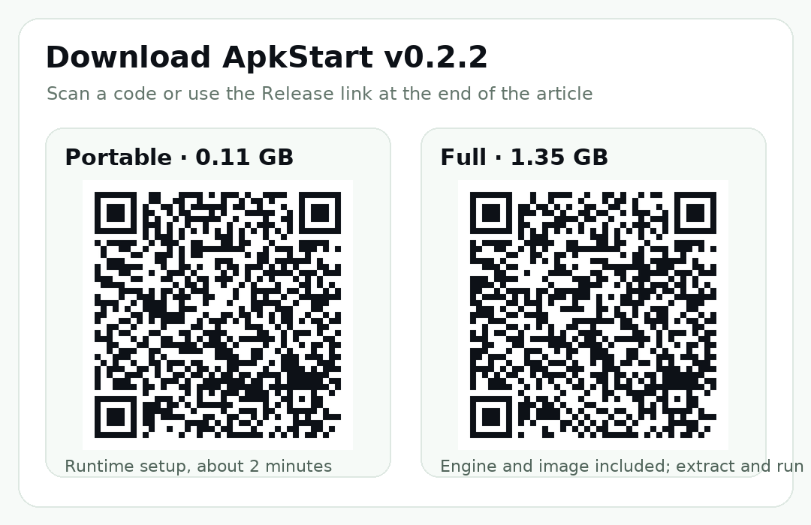

# Run Android apps on your PC by double-clicking an APK

Running an Android app on Windows often means downloading several gigabytes of emulator software, setting it up, finding an APK, dragging it into an emulator, and tolerating extra windows and loud fans. Installation can still fail with `INSTALL_FAILED_NO_MATCHING_ABIS` when an APK contains only ARM native libraries.

That is why I built **ApkStart**.

ApkStart is a lightweight Windows Android app launcher. Associate `.apk` files with it and **double-click to install**. It reads the app name and icon, creates a desktop shortcut, and opens each app in its own window. A shared folder also lets you move files between Windows and Android.

## Four features, ready to use

**1. Double-click to install.** Associate `.apk` files with ApkStart. It reads the app name and icon and creates a desktop shortcut without opening an emulator console.

**2. Separate app windows.** Each app runs in its own resizable window (`am start --windowingMode 5`) and can be arranged like a native Windows application.

**3. Shared files.** `%USERPROFILE%\ApkStartShared` is connected to Android's shared directory, so files copied or dragged there can be opened by Android apps.

**4. Official engine and hardware acceleration.** ApkStart uses the official Google Android Emulator and AEHD driver. Runtime components are downloaded in parallel from official sources, verified, and managed by the app; the shell has no third-party runtime dependencies.

## v0.2.2: less setup, more compatibility

This release brings two major changes.

**The full package works out of the box.** The first launch used to require clicking **Set up runtime** and downloading the engine and system image (about two minutes). The full package now includes the runtime engine, platform-tools, AEHD driver, and an Android 14 compatibility image with an ARM translation layer. Extract and run `ApkStart.exe` to open the main screen—**no download or setup required**.

**ARM-only apps work better.** Apps such as Hongguo Short Drama, which contain only `arm64-v8a` libraries, crashed after the privacy dialog on the old API 30 image (`libndk_translation` / `DoBadTrampoline`). The updated translation layer in the Android 14 image passed installation, opened the recommendation feed, and played and switched videos without crashing in the reported test.

Enable **ARM compatibility mode** in Settings. Other ARM-only apps can benefit too. Apps with stronger anti-emulator checks (for example, checks for real sensors or baseband) may still be limited.

## Downloads: choose a package

> The WeChat article cannot attach installers, so this page includes QR codes that link directly to the downloads. Long-press a code to scan it, or use **Read more** at the end of the article to open the GitHub Release.

| Package | Size | Best for |
| --- | --- | --- |
| Portable `win64-portable.zip` | 0.11 GB | Click **Set up runtime** on first launch; the engine and image install in about two minutes. |
| **Full `win64-full.7z.001` (recommended)** | 1.35 GB | Includes all components and the ARM compatibility image; extract and run with no download or setup. |

The full package is a 7z archive. Extract the `.001` file with 7-Zip, WinRAR, or Bandizip; this release has one volume. Both packages are portable and do not require administrator installation.

The project is open source: <https://github.com/RoutineMiku/apkstart>. Stars, issues, and pull requests are welcome. GitHub Actions builds and publishes both packages when a release tag is pushed.

## About the author

**ApkStart is developed and maintained by RoutineMiku.** Powered by RoutineMiku.

WeChat and Douyin QR codes are included below and in **Settings → About**. Reach out if you need help.

Douyin: **RoutineMiku** — <https://v.douyin.com/9TIIxVCANig/>

---

*ApkStart is licensed under MIT. The portable package downloads runtime components from official Google sources on the user's machine. The full package bundles those components for convenience; each bundled component remains subject to its own license.*
